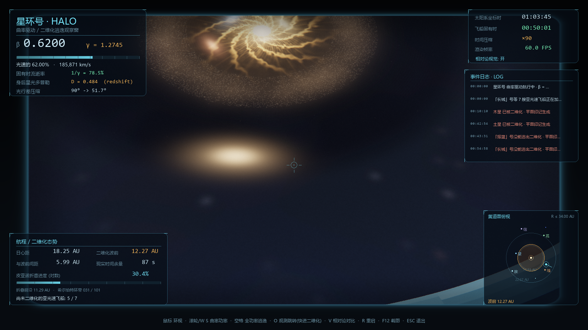
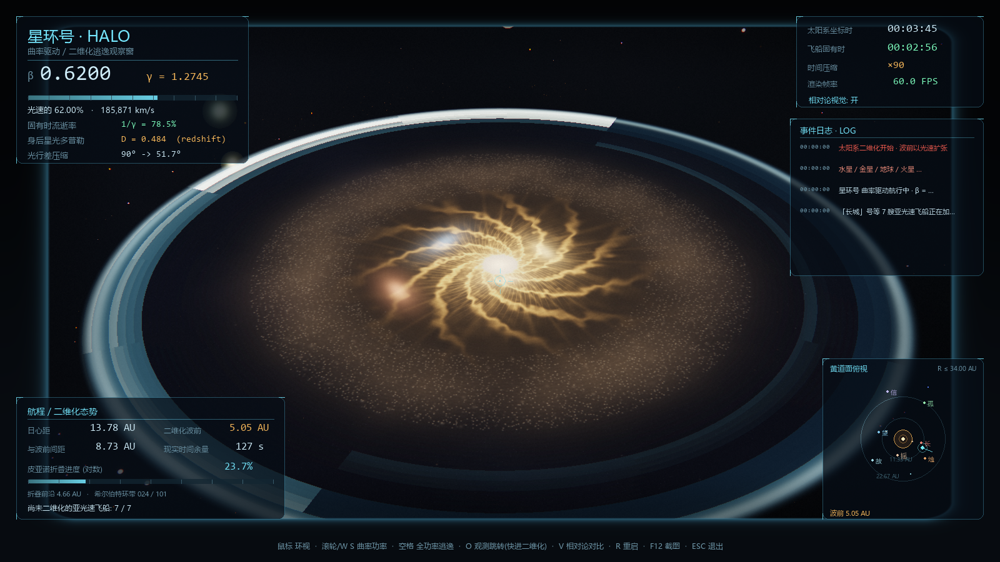
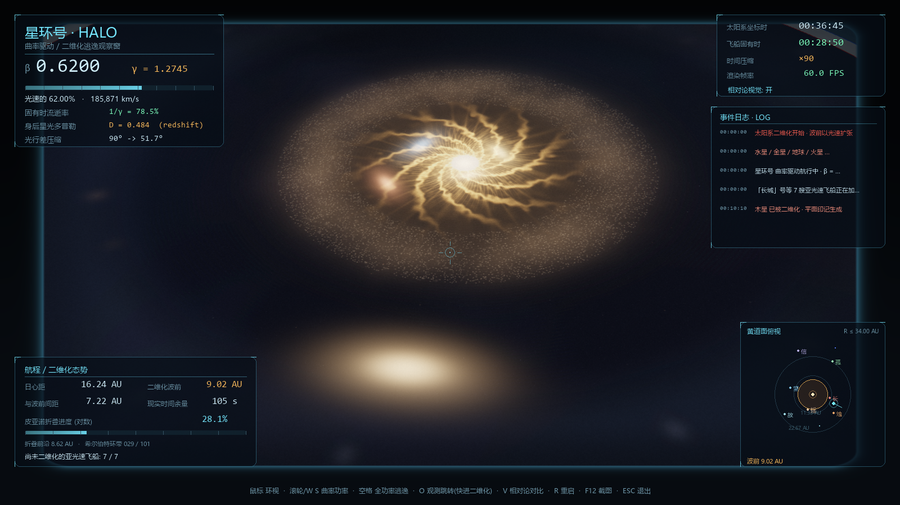
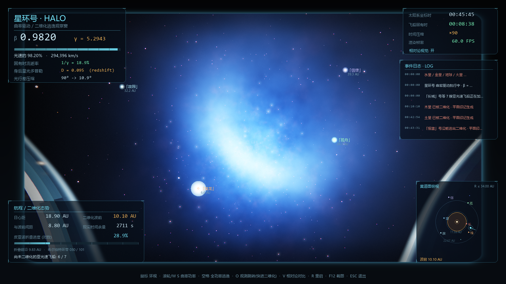
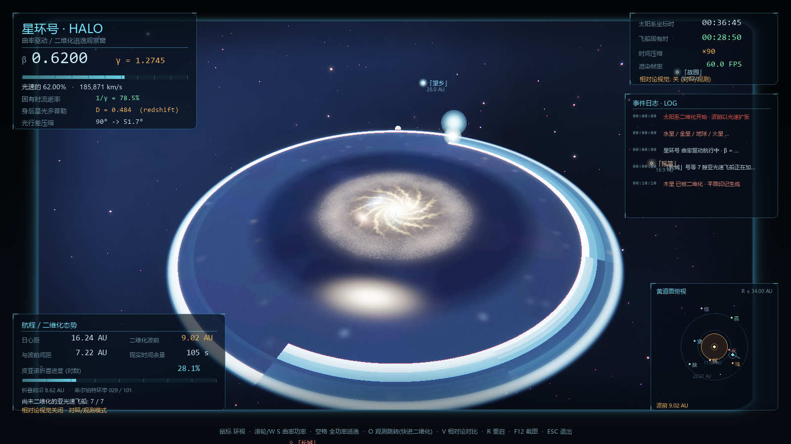
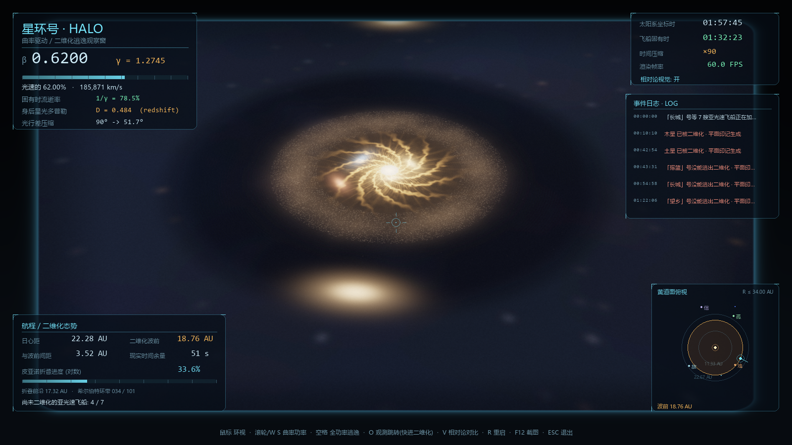
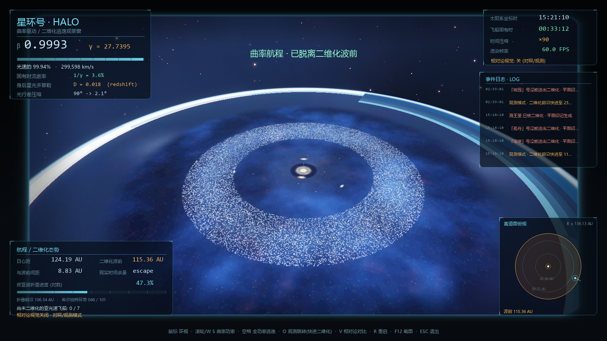
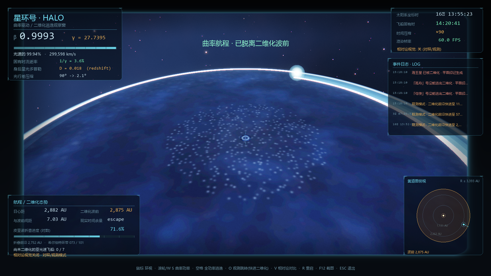
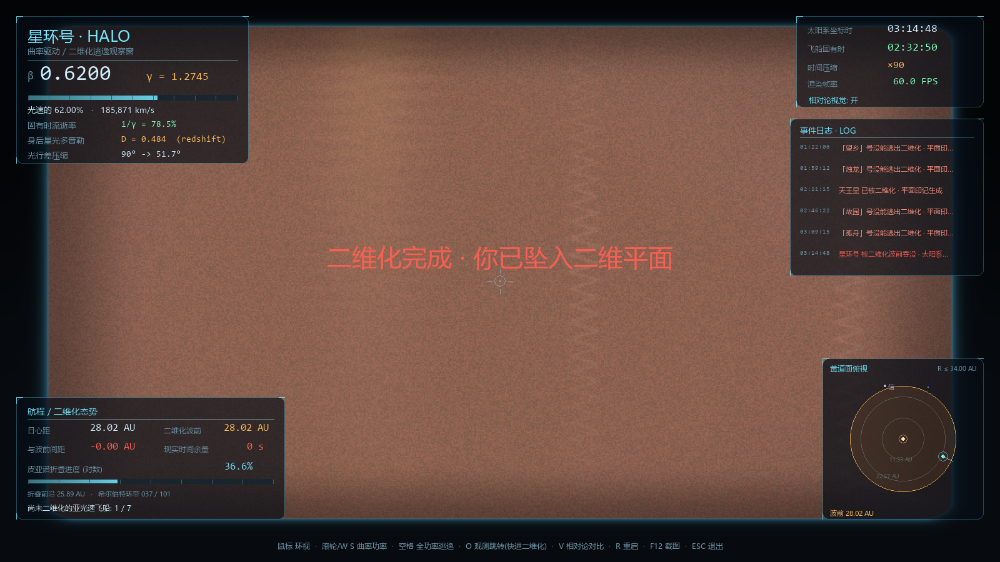
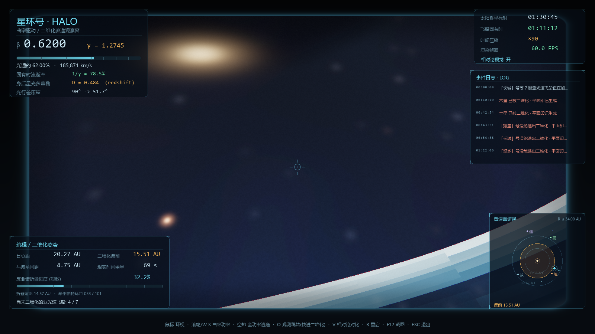

# 星环号 · 二维化逃逸 / HALO · Death's End

**中文** | [English](README.en.md)

> 用 **Python 3.13 + OpenGL 3.3** 实时渲染的《三体 III · 死神永生》场景再现：
> 坐在光速飞船「星环号」的舷窗里，看着太阳系被一张以光速扩张的二维平面吞噬。
> 鼠标可自由环视窗外按**希尔伯特/皮亚诺曲线**折叠的二维化平面、被压扁的行星、
> 明显可见的小行星带与柯伊伯带，以及 7 艘正在绝望加速的亚光速逃亡飞船。
> 二维化绘画范围一路延伸到**奥尔特云（12 万 AU）**；飞船上的一切观测都经过
> **狭义相对论**处理：光行差、多普勒频移与集束、时间膨胀。

*Halo escaping the 2-D collapse of the Solar System — a real-time, relativistic
OpenGL visualization inspired by Liu Cixin's "Death's End" (Remembrance of Earth's Past #3).*

[](https://www.python.org/)
[](https://www.opengl.org/)
[](https://www.pygame.org/)
[](https://moderngl.readthedocs.io/)
[](#requirements)



**目录** · [项目特色](#features) · [快速开始](#quickstart) · [操作](#controls) · [验收对照](#acceptance) ·
[物理与算法](#physics) · [截图](#screenshots) · [项目结构](#structure) · [性能与验证](#perf) ·
[说明与限制](#notes) · [更新日志](#changelog) · [English](README.en.md)

---

<a id="features"></a>

## 一、项目特色

- **窗外就是相对论**：每个像素都做光行差变换与多普勒频移/集束。$\beta \to 1$ 时整片星空
  压缩进前向光锥、身后红移变暗；HUD 实时显示 $\beta$、$\gamma$、固有时流逝率、身后多普勒
  因子与光行差角。按 `V` 可一键切换到“牛顿式”对照视角。
- **希尔伯特（皮亚诺）式二维化**：平面被切成 101 个等比环带，每个环带内部按
  $2^{10}\times 2^{10}$ 单元的希尔伯特曲线顺序折叠；“二维化时刻”等于沿空间填充曲线
  前进的距离。光速波前始终领先折叠笔迹约 0.62 个环带，所以能一直看到发光的分形折叠前线。
- **太阳系全尺度绘画**：四层多尺度纹理从太阳一直铺到 **12 万 AU 的奥尔特云**，
  包括小行星带、完整柯伊伯带、离散盘、内/外奥尔特云；行星、飞船被压扁时会在平面上
  留下带运动方向的彩色印记。
- **7 艘亚光速逃亡飞船**：引擎辉光、拉长尾迹、HUD 空间标签、黄道面俯视小地图；
  被波前追上时压扁、闪光、留下印记并写入事件日志。
- **真实的“只有光速才能逃逸”**：二维化以光速扩张，$\beta=0.99935$ 也只是贴着波前跑；
  一旦降速，HUD 会撤销“已脱离”标语、给出有限的逼近时间，波前最终会吞没飞船。
- **实时性能**：1600×900 下 230–290 FPS（隐藏窗口 GPU 渲染耗时），交互锁定 60 FPS。

<a id="quickstart"></a>

## 二、快速开始

### Requirements

- **Python 3.13**（开发与测试环境为 3.13.12）
- 依赖：`numpy`、`scipy`、`Pillow`、`pygame 2.6+`、`moderngl 5.8+`
- 支持 **OpenGL 3.3 Core** 的显卡与驱动
- 开发测试环境：Windows 11 · Intel Core Ultra 7 155H · Intel Arc Graphics
- 中文字体：Windows 使用微软雅黑；Linux/macOS 会自动尝试常见 CJK 字体
  （Noto Sans CJK / 文泉驿 / PingFang 等）

### 安装与运行

```bash
git clone https://github.com/nijitasogare-blip/Halo-Escaping-Simulator.git
cd Halo-Escaping-Simulator

python -m pip install -r requirements.txt
python run.py
```

Windows 也可以直接双击 `run.bat`。

> **首次启动**会生成四张「二维化绘画纹理」（inner $2048^2$ / outer $2048^2$ /
> mid $1024^2$ / far $1024^2$，覆盖 $0$ – $120{,}000$ AU）并缓存到 `cache/`，
> 约 **30 秒**；之后启动 $< 1$ 秒。`cache/` 已加入 `.gitignore`，不会提交到仓库。

### 命令行参数

| 参数 | 说明 |
| --- | --- |
| `--width 1920 --height 1080` | 窗口尺寸（默认 1600×900） |
| `--scale 1.25` | 内部渲染倍率（>1 超采样，<1 提升帧率） |
| `--time-scale 45` | 初始时间压缩倍率（默认 $90\times$，范围 $5$–$800\times$） |
| `--beta 0.55` | 初始 $\beta$（默认 0.62） |
| `--shots` | 隐藏窗口生成全部验收截图 + GIF 后退出 |
| `--no-gif` | `--shots` 时不生成 GIF |
| `--benchmark` | 隐藏窗口渲染性能测试 |
| `--selftest` | 端到端自检（渲染 / HUD / 相对论 / 二维化吞噬 / 回归测试） |
| `--demo` | 隐藏窗口试运行主循环 4 秒 |

<a id="controls"></a>

## 三、操作

| 输入 | 功能 |
| --- | --- |
| **鼠标移动** | 自由环视（第一人称，舷窗视角） |
| 鼠标滚轮 / `W` `S` | 曲率驱动功率（$\beta \in [0.10, 0.9995]$） |
| **`空格`** | 曲率驱动全功率（$\beta \to 0.99935$），开始真正甩开二维化波前 |
| **`O`** | **观测跳转**：二维化前沿快进 $5\times$，直接巡视柯伊伯带 / 奥尔特云；保持飞船与波前间距、不改变相对论视觉开关 |
| `V` | 关闭 / 开启相对论视觉效果（光行差 + 多普勒），用于对照 |
| `-` / `=` | 降低 / 提高时间压缩倍率（$5\times$–$800\times$） |
| `方向键` | 备用环视 |
| `H` | 隐藏 / 显示 HUD |
| `F12` | 截图到 `screenshots/` |
| `F` | 全屏 |
| `ESC` | 释放鼠标 / 再按退出 |

> 默认鼠标已被捕获，进入即可环视；按 `ESC` 释放鼠标后再操作窗口。
> 如果波前追上星环号，会播放“被压成二维油画”的吞噬特效后自动重启。

<a id="acceptance"></a>

## 四、场景与验收对照

| 需求 | 实现 |
| --- | --- |
| **鼠标移动摄像机方向** | 第一人称相对鼠标环视，yaw/pitch 平滑；方向键备用 |
| **观察窗外的二维化过程** | 光速扩张的二维化平面；希尔伯特曲线逐环带折叠；可见折叠前线、能量网格、已完成折叠的二维油画；行星被压扁→消失→留下平面印记 |
| **观察其他低于光速的逃亡飞船** | 7 艘亚光速飞船，引擎辉光、尾迹、HUD 标签、小地图光点；被追上时压扁、闪光、留下印记并写入事件日志 |
| **光速飞船的相对论效应** | 逐像素光行差、多普勒频移与相对论集束、时间膨胀（坐标时 vs 固有时）；HUD 显示 $\beta$、$\gamma$、固有时流逝率、身后多普勒、光行差压缩角；`V` 键对照 |
| **用皮亚诺曲线思路模拟二维化** | 每个环带按 $2^{10}\times2^{10}$ 单元的希尔伯特曲线顺序遍历；波前是曲线前缀，发光折叠笔迹可见 |
| **小行星带 / 柯伊伯带 / 奥尔特云** | 小行星带（$2.06$–$3.34$ AU）与柯伊伯带（$30$–$50$ AU）以“尘埃辉光 + 分层碎屑 + 明亮主带天体”渲染；绘画范围覆盖离散盘与内/外奥尔特云，直到 $120{,}000$ AU |
| **动态的“已脱离”判定** | 只有曲率驱动仍处全功率档位且当前 $\beta \ge 0.999$ 时才显示“已脱离二维化波前”；降速/降功率立即撤销，并记录“波前重新逼近” |

<a id="physics"></a>

## 五、物理与算法

### 5.1 狭义相对论观测

星环号相对太阳系以 $\beta c$ 沿单位向量 $\hat{u}$ 飞行，洛伦兹因子为

$$
\gamma = \frac{1}{\sqrt{1-\beta^2}} .
$$

对每个屏幕像素：

1. 由相机姿态得到飞船系中的**表观方向** $\hat{d}_{\mathrm{app}}$；
2. 反向洛伦兹助推得到该光线在太阳系静止系中的来源方向 $\hat{d}_{\mathrm{rest}}$。
   令 $n = -\hat{d}$ 为光子传播方向，则

$$
n'_x = \frac{n_x-\beta}{1-\beta n_x},\qquad
n'_\perp = \frac{n_\perp}{\gamma\,(1-\beta n_x)} ,
$$

   其中平行/垂直分量均相对速度方向 $\hat{u}$ 分解；
3. 多普勒因子与相对论集束为

$$
D = \frac{1}{\gamma\,\bigl(1-\beta\,\hat{d}_{\mathrm{app}}\cdot\hat{u}\bigr)},\qquad
\nu_{\mathrm{obs}} = D\,\nu_{\mathrm{emit}},\qquad
I_{\mathrm{obs}} = D^3\,I_{\mathrm{emit}} .
$$

   作为参考，静止系中方向角 $\theta$ 与表观角 $\theta'$ 的关系为

$$
\tan\frac{\theta'}{2} = \sqrt{\frac{1-\beta}{1+\beta}}\,\tan\frac{\theta}{2},
$$

   因此 $\beta=0.9995$ 时 $90^\circ$ 方向被压缩到约 $1.8^\circ$，$D$ 从正前方约 $63$ 变到
   正后方约 $0.016$；
4. 恒星按 $T_{\mathrm{obs}} = D\,T_{\mathrm{rest}}$ 重新取黑体颜色；行星/二维平面等
   彩色表面使用近似的通道增益 + $D^2$ 亮度修正（HUD 中显示的 $D$ 是精确值）；
5. 时间膨胀：$d\tau = dt/\gamma$，HUD 同时显示太阳系坐标时与飞船固有时。

### 5.2 二维化平面与希尔伯特折叠

平面按等比环带划分：

$$
r \in \bigl[R_0 Q^k,\; R_0 Q^{k+1}\bigr),\qquad
R_0 = 0.22\ \mathrm{AU},\quad Q = 1.14,\quad k = 0,\dots,100 .
$$

对平面上的点 $(x,z)$，令 $r = \sqrt{x^2+z^2}$、$\theta = \mathrm{atan2}(z,x)$：

$$
u = \frac{\theta}{2\pi}+\frac{1}{2},\qquad
\rho = \frac{r-r_k}{r_{k+1}-r_k},
$$

$$
h = \mathrm{Hilbert}_{10}\!\bigl(\lfloor uS\rfloor,\ \lfloor \rho S\rfloor\bigr),
\qquad S = 2^{10},
$$

$$
\mathrm{reveal}(x,z) = \frac{r_k + (r_{k+1}-r_k)\,h/S^2}{R_{\mathrm{norm}}} .
$$

渲染端（GLSL）与 Python 端实现同一函数，$\mathrm{reveal}(x,z) < p$ 的像素
视为“已折叠”，其中 $p$ 为当前折叠进度。$p$ 落后平面外缘约 $0.62$ 个环带宽度，
因此二维化平面上始终留着一圈正在被希尔伯特曲线填充的活动区，前沿就是发光的分形折叠笔迹。

### 5.3 多尺度二维化绘画纹理

| 纹理 | 范围 | 内容 |
| --- | --- | --- |
| `inner` $2048^2$ | $0$ – $6.4$ AU | 太阳玫瑰花结、小行星带、内太阳系星尘 |
| `outer` $2048^2$ | $6.4$ – $80$ AU | 完整柯伊伯带（$30$–$50$ AU）、类冥天体、离散盘内侧 |
| `mid` $1024^2$ | $80$ – $3000$ AU | 离散盘外侧、内奥尔特云 |
| `far` $1024^2$ | $3000$ – $120{,}000$ AU | 奥尔特云主体（冰尘云团 + 彗星核） |

内容全部是世界坐标的解析函数/哈希点集，四层按半径在着色器中平滑混合。
**行星轨道不画成圆圈**——真实空间中轨道只是运动轨迹，没有可见的“圈”；平面上只保留
真实物质（太阳、行星位置、尘埃带、星尘）以及行星/飞船被压扁时的印记。

### 5.4 渲染管线

```text
世界光线追踪 (HDR RGBA16F)
  ├─ 逐像素相对论光行差 + 多普勒
  ├─ 星云 / 三层恒星场（黑体颜色）
  ├─ 二维化平面（四层纹理 + 希尔伯特 reveal + 折叠笔迹 + 印记 + 太阳辉光）
  ├─ 8 颗行星（椭球压扁动画 + 条纹 + 大气边缘 + 覆盖抗锯齿）
  └─ 星空背景遮挡
点精灵（加性混合）：尘埃 / 7 艘飞船 + 尾迹 / 折叠笔尖 / 火花
亮部提取 → 两级高斯 Bloom
GPU 自适应曝光（仅统计非黑像素亮度）
合成：ACES 色调映射 / 轻微色散 / 舷窗框 + 玻璃反射 / 暗角 / 二维化吞噬特效 / HUD
```

HUD 使用 pygame 字体渲染成 Surface 再上传纹理：相对论读数、双时钟、航程/态势、
希尔伯特环带号、事件日志、黄道面俯视小地图、飞船空间标签与警告，全部中文。

### 5.5 飞船、行星与二维化吞噬

- 星环号沿固定逃逸方向径向飞行；$\beta$ 平滑趋近用户设定，$dr = \beta c\,dt$；
- 行星做慢速公转（艺术处理：显示半径放大约 100–500 倍，否则在此尺度下不可见）；
- 行星/飞船的二维化判据：其平面投影位置的 $\mathrm{reveal}$ 小于当前
  $p$ 时被吞噬 → 压扁动画、闪光、在平面上生成沿运动方向的拉长印记；
- 波前追上星环号（$r_{\mathrm{ship}} \le R_{\mathrm{wave}}$）时触发全屏
  “二维化吞噬”特效，11 秒后自动重启；
- 按空格全功率后 $\beta \to 0.99935$；若之后降速或降功率，“已脱离”标语立即撤销，
  HUD 显示有限的逼近时间，波前重新逼近——这正是“只有光速才能逃逸”的核心设定。

### 5.6 观测模式（`O` 键）

真实二维化以光速推进，到达奥尔特云需要上万年。`O` 键是可视化辅助：
把二维化前沿快进 $5\times$，**保持飞船与波前的间距一起向外平移**（多次快进也不会被
强制二维化），并保留当前相对论视觉开关。$\beta\approx 1$ 时外围平面会被多普勒集束压暗，
需要看清外围结构时自行按 `V` 切换。HUD 中的物理读数始终按真实公式计算。

<a id="screenshots"></a>

## 六、截图

| 首次观察（相对论 ON） | 希尔伯特折叠前线 |
| --- | --- |
|  |  |
| **太阳玫瑰花结** | **全功率逃逸：星光压缩成前向光锥** |
|  |  |
| **相对论对照模式（V）** | **整个太阳系** |
|  |  |
| **柯伊伯带（O 观测跳转）** | **奥尔特云（O 观测跳转）** |
|  |  |
| **被二维化吞噬** | **近看二维化平面** |
|  |  |

动态预告：[`screenshots/halo_teaser.gif`](screenshots/halo_teaser.gif)（76 帧，镜头缓慢环视）

> `09`/`10` 使用 `O` 观测跳转拍摄；为看清外围平面，拍摄时按 `V` 关闭了相对论视觉。

重新生成全部截图 / GIF：

```bash
python run.py --shots --outdir screenshots
```

<a id="structure"></a>

## 七、项目结构

```text
Halo-Escaping-Simulator/
├─ run.py                 入口（argparse）
├─ run.bat                Windows 启动脚本
├─ requirements.txt
├─ README.md / README.en.md
├─ halo/
│  ├─ config.py           场景常数、行星/飞船数据、调色、多尺度范围
│  ├─ relativity.py       光行差 / 多普勒 / 黑体颜色
│  ├─ hilbert.py          希尔伯特曲线 + 环带 reveal 场 + 笔尖位置
│  ├─ painting.py         四层二维化绘画纹理生成（含小行星带/柯伊伯带/奥尔特云）
│  ├─ sim.py              状态机：飞船、波前、行星、难民船、尘埃、火花、事件
│  ├─ viewmath.py         相机基、投影、空间标签、时间格式化
│  ├─ shaders.py          GLSL：世界光追 / 点精灵 / Bloom / 曝光 / 合成
│  ├─ renderer.py         OpenGL 管线与 FBO/纹理管理
│  ├─ hud.py              pygame 中文仪表盘 + 小地图 + 事件日志
│  └─ app.py              主循环 / 输入 / 截图模式 / 自检 / 基准测试
├─ tools/verify_physics.py  数学与尺度自检
├─ cache/                绘画纹理缓存（首次运行后生成，已 gitignore）
├─ shots/                调试输出目录（已 gitignore）
└─ screenshots/          验收截图 + GIF
```

<a id="perf"></a>

## 八、性能与验证

测试环境：Windows 11 · Intel Core Ultra 7 155H · Intel Arc Graphics · OpenGL 3.3

```bash
python run.py --benchmark --width 1600 --height 900
# 300 frames @ 1600x900: 约 1.0~1.3s -> 230~290 fps（隐藏窗口 GPU 渲染耗时，不含垂直同步）
```

交互模式以 60 FPS 垂直同步运行；`--scale` 控制内部渲染倍率（1.25 可超采样，
0.7 适合远程桌面/低配机器）。

```bash
python tools/verify_physics.py
# 希尔伯特双射/逆映射/相邻性、光行差往返、多普勒解析式与四动量变换一致性、
# 太阳系多尺度范围（小行星带→柯伊伯带→奥尔特云）等

python run.py --selftest
# 隐藏窗口跑完整管线：鼠标视角/全功率/降速撤销逃逸标语/恢复/
# 连续观测跳转不被强制二维化/二维化吞噬/重置

python run.py --demo
# 隐藏窗口试运行主循环 4 秒
```

<a id="notes"></a>

## 九、科学说明与艺术处理

**严谨的部分**

- 光行差、多普勒、相对论集束、时间膨胀的公式与数值；
- 二维化以光速扩张，只有接近光速才能真正逃逸；
- 望远镜/HUD 读数为精确值；希尔伯特折叠顺序在渲染端与 Python 端逐位一致。

**艺术放大的部分（已知限制）**

- 行星 3D 显示半径放大约两个数量级；
- 时间压缩默认 $90\times$（HUD 明示），否则场景在人类时间尺度上几乎静止；
- 多普勒染色强度做了 $0.35$ 倍的视觉收敛，HUD 数字仍精确；
- 小行星带/柯伊伯带/奥尔特云的团块与亮度做了强化，便于观察（真实尘埃带更稀疏）；
- 二维化平面的希尔伯特折叠、能量网格、二维油画纹样是对原著的原创视觉化解释，
  并非原著文字的字面描述；极坐标映射在 $\theta=\pi$ 处存在一条“折痕”（环带填充接缝）；
- 7 艘亚光速飞船名称与轨迹为虚构，用于呈现“低于光速就无法逃脱”的悲剧感；
- `O` 观测跳转是可视化辅助，不改变物理公式；
- 项目为个人学习/非商业同人作品，与《三体》版权方无关；原著版权归刘慈欣所有。

**推荐观察流程**：启动后先左右环视看星空与身后的太阳系 → 滚轮把 $\beta$ 降到 0.45 左右
欣赏二维化平面的展开与折叠笔迹 → 等波前接近时按 `空格` 全功率，感受星空瞬间压缩进
前方光锥、身后的太阳系红移变暗 → 按 `V` 对照；之后按 `O` 巡游柯伊伯带与奥尔特云。

<a id="changelog"></a>

## 十、更新日志

**v1.0.0 — 2026-10-27**

- 首个公开版本：相对论舷窗、希尔伯特二维化、8 颗行星、7 艘难民船、HUD/小地图/事件日志；
- 多尺度绘画纹理扩展到 12 万 AU 的奥尔特云，小行星带/柯伊伯带增强；
- `O` 观测跳转（保持飞船-波前间距，不改变相对论视觉开关）；
- “已脱离二维化波前”标语改为动态判定：只在全功率且 $\beta\ge 0.999$ 时显示，降速立即撤销；
- 四层纹理缓存、自适应曝光、Bloom、ACES、中文 HUD、自检与基准测试模式；
- README 支持 GitHub MathJax LaTeX 公式，并新增英文版 [`README.en.md`](README.en.md)。

## 十一、致谢与声明

- 灵感来自刘慈欣《三体 III · 死神永生》（*Death's End*）中的太阳系二维化与光速飞船；
- 技术栈：Python、pygame、moderngl、NumPy、SciPy、Pillow；
- 本项目为个人学习与非商业同人作品，代码仅供学习与交流。如涉及版权问题请告知，
  会及时处理。

如果这个项目让你想起第一次读到“太阳系二维化”时的震撼，欢迎点一个 ⭐。
